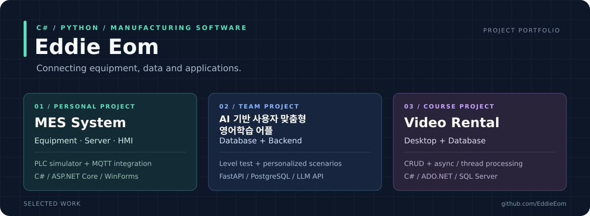

  

### 엄유준 · 제조 현장 경험을 소프트웨어 개발로 연결하고 있습니다

한국폴리텍대학 부산캠퍼스 소프트웨어융합과 · **C# / MES / 백엔드 개발**

[대표 MES 프로젝트](https://github.com/EddieEom/MES-System) · [VIPA 백엔드](https://github.com/VipaForENG/Vipa_backend) · [이메일](mailto:pom159753@gmail.com)

     

## 한눈에 보는 구현 경험

| 프로젝트 | 직접 맡은 부분 | 확인한 결과 |
| :--- | :--- | :--- |
| **🏭 [MES-System](https://github.com/EddieEom/MES-System)** 개인 프로젝트 | 설비 통신 · 서버 · DB · HMI 연결 | 가상 설비 양방향 통신 생산 현황·이력 조회 및 제어 |
| **💬 [VIPA](https://github.com/VipaForENG/Vipa_backend)** 팀 프로젝트 | **DB 설계 및 백엔드 전체** 프론트엔드 초기 구조 | 앱 레벨 테스트 결과 기반 맞춤 시나리오 생성 |
| **🖥️ [VideoRentalSystem](https://github.com/EddieEom/VideoRentalSystem)** 수업 프로젝트 확장 | WinForms · ADO.NET CRUD 비동기·스레드 처리 추가 | 비디오·고객·대여 관리 조회 및 Excel 출력 |

## 🏭 대표 프로젝트 · MES-System

> **HMI에서 명령을 보내고, 가상 설비의 생산 데이터를 다시 화면으로 연결했습니다.**

<b>가상 설비 화면 보기</b>

<table>
<tr>
<td width="50%" valign="top">
<b>제어와 통신</b>  
• GX Works2 · GX Simulator2 · MX Component 
• HMI의 START / STOP / RESET 명령 전달 
• MELSOFT Gemini 가상 생산 공정 연동
</td>
<td width="50%" valign="top">
<b>수집과 모니터링</b>  
• MQTT 수신 → ASP.NET Core → SQL Server 
• WinForms 생산 현황 · 설비 상태 표시 
• 제품 이동 · 검사 결과 · 알람 이력 관리
</td>
</tr>
</table>

**개인 개발** · **시뮬레이터 환경에서 동작 확인** · [구조·구현 내용 보기 →](https://github.com/EddieEom/MES-System)

## 💬 VIPA · AI 영어 학습 앱

**팀 프로젝트 / DB 설계·백엔드 전체 담당 / 프론트엔드 초기 구조 구성**

<table><tr><th>① 레벨 테스트</th><th>② 평가 결과</th><th>③ 시나리오 생성</th><th>④ 실전 회화</th></tr><tr><td width="25%"></td><td width="25%"></td><td width="25%"></td><td width="25%"></td></tr></table>

레벨 테스트 결과를 바탕으로 사용자에게 맞는 회화 시나리오를 생성하는 흐름을 앱에서 확인했습니다. 화면 UI와 프론트엔드 구현은 팀원이 담당했습니다.

[백엔드 코드 →](https://github.com/VipaForENG/Vipa_backend) · [프론트엔드 코드 →](https://github.com/VipaForENG/Vipa_frontend)

## 🖥️ C# 비디오 대여 관리

**WinForms·ADO.NET CRUD 구현 후 비동기·스레드 처리 추가**

[구현 과정과 코드 →](https://github.com/EddieEom/VideoRentalSystem)

## 🧩 개인 실험과 학습 기록

| 프로젝트 | 경험 |
| :--- | :--- |
| [Sadie](https://github.com/EddieEom/Sadie-backend) | AI Hub 데이터 전처리 · A100 서버의 LLaMA 학습 실험 · 대화 앱 연동 |
| [MindBuilder](https://github.com/EddieEom/MindBuilder) | 생각 정리를 위한 FastAPI · PostgreSQL · Flutter 개인 프로토타입 |
| [MDI 메모장](https://github.com/EddieEom/csharp-winforms-mdi-notepad) | 다중 문서 · 파일 입출력 · 이벤트 처리 |
| [부산 공영주차장](https://github.com/EddieEom/Busan_Parking_Website) | 생성형 AI 활용 웹 제작 수업 · Cloudflare 배포 · 기능 확인 |

---

제조 현장 근무 경험을 바탕으로 **설비 통신·데이터 처리·사용자 화면을 연결하는 개발**에 관심을 두고 있습니다.
