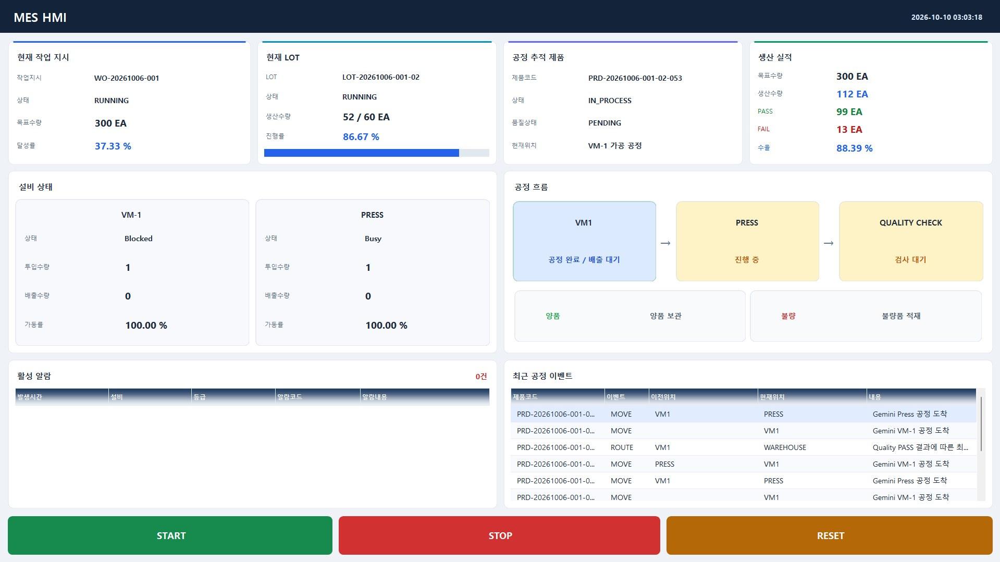

# 엄유준

C# MES 개발자로 취업을 준비하고 있습니다.  
한국폴리텍대학 부산캠퍼스 소프트웨어융합과에서 개발을 공부하고 있습니다.

LG이노텍과 CJ제일제당에서는 생산설비를 운영했습니다. 현장에서는 설비를 돌리고 MES로 제품을 다음 공정에 넘기는 일을 했고, 지금은 그때 사용했던 화면과 데이터 처리를 직접 만들어 보고 있습니다.

## 가장 집중해서 만든 프로젝트

### [디지털 트윈 기반 PLC 설비 제어 프로그램](https://github.com/EddieEom/MES-System)

화면에서 명령을 보내고 설비에서 나온 데이터를 다시 받아보는 구조를 만들고 싶었습니다. 제공받은 가상 설비에 C# Gateway, ASP.NET Core 서버, MSSQL, WinForms HMI를 연결했습니다.

생산 데이터는 MQTT로 받고, 제어 명령은 SignalR와 PLC 통신으로 보냈습니다. 서로 다른 프로그램을 연결하면서 각 역할과 데이터 흐름을 공부했습니다. 동작은 PLC 시뮬레이터와 가상 설비에서 확인했습니다.

## C#과 DB 공부

### [비디오 대여 관리](https://github.com/EddieEom/VideoRentalSystem)

수업에서 시작한 WinForms 프로그램에 비동기 DB 처리를 추가했습니다. 저장 프로시저 호출과 DB 정규화를 공부하며 고객·비디오·대여 정보를 관리하는 기능을 구현했습니다.

### [MDI 메모장](https://github.com/EddieEom/csharp-winforms-mdi-notepad)

WinForms 기초를 공부한 프로젝트입니다. 부모·자식 폼, 메뉴 이벤트, 파일 열기·저장을 다뤘습니다.

## 팀 프로젝트

### [VIPA 영어회화 학습 앱](https://github.com/VipaForENG/Vipa_backend)

DB 설계와 FastAPI 백엔드를 맡고 팀원의 Flutter 화면과 연결했습니다. AI API, Render, Supabase를 사용했고, Hugging Face의 기존 모델로 구어체 데이터의 영어 문장을 CEFR 수준별로 분류했습니다.

## 관심이 생겨서 해본 실험

### [부산 공영주차장](https://github.com/EddieEom/Busan_Parking_Website)

AI 코드 생성을 적극 활용한 수업 프로젝트입니다. 공공데이터 API와 MCP 서버를 연결하고 Cloudflare에 배포해 봤습니다.

### [MindBuilder](https://github.com/EddieEom/MindBuilder)

AI를 질문에 답하는 용도 외에 어떻게 쓰면 좋을지 고민하다 시작했습니다. 나의 성장을 위한 '인간 운영체제'라는 아이디어를 질문·기록·분석·추천 기능으로 옮겨 본 프로토타입입니다.

### [Sadie](https://github.com/EddieEom/Sadie-backend)

LLM 파인튜닝이 궁금해서 A100 GPU 2개가 장착된 학교 서버에서 데이터 전처리와 학습을 시도했습니다. 뚜렷한 응답 개선까지 확인하지는 못했습니다. 현재 저장소에는 외부 LLM API를 사용하는 대화 앱 백엔드가 있습니다.

---

주로 공부하는 기술: C# · WinForms · ASP.NET Core · MSSQL  
팀 프로젝트와 실험: Python · FastAPI · PostgreSQL  
[이메일](mailto:pom159753@gmail.com)
