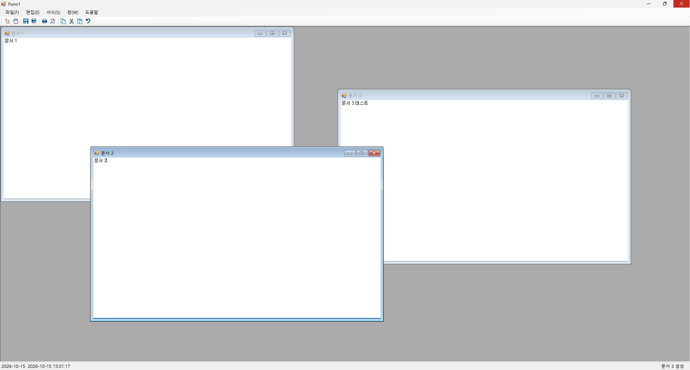

# 엄유준 | Yoojun Eom

**Junior Software Developer**

제조 현장에서 설비를 운전했던 경험을 바탕으로 소프트웨어 개발을 공부하고 있습니다. 응용 프로그램, 백엔드, 데이터베이스, 설비 통신, AI 서비스 등 다양한 프로젝트를 진행하며 화면에서 입력한 정보가 시스템 내부에서 어떻게 처리되는지 익히고 있습니다.

[Projects](#projects) · [Experience](#experience) · [Education](#education) · [Technical Skills](#technical-skills) · [Contact](#contact)

---

## Projects

프로젝트 이미지 또는 제목을 클릭하면 소스코드와 상세 개발 기록을 확인할 수 있습니다.

### 01 — Industrial & Desktop Applications

<table>
<tr>
<td width="50%" valign="top">

<h3><a href="https://github.com/EddieEom/MES-System">디지털 트윈 프레스 공정 제어</a></h3>

<strong>졸업작품 · 교내 프로젝트 작품 경진대회 동상</strong>

가상 설비 제어와 생산정보 수집·저장·조회를 연결한 MES 프로젝트입니다.

<ul>
<li>HMI → 서버 → Gateway → PLC 시뮬레이터 제어</li>
<li>MQTT 제품 이동·검사 결과 수집, LOT 이력 관리</li>
<li>발행 프로세스 재사용 후 동일 조건에서 재시험</li>
</ul>

<code>C#</code> <code>WinForms</code> <code>ASP.NET Core</code> <code>SQL Server</code> <code>MQTT</code> <code>SignalR</code> <code>MX Component</code>

<a href="https://github.com/EddieEom/MES-System">소스코드</a> · <a href="https://github.com/EddieEom/MES-System/blob/main/docs/media/hmi-gemini-demo.mp4">시연 영상</a> · <a href="https://github.com/EddieEom/MES-System/blob/main/docs/validation/mqtt-reliability.md">통신 시험</a>

</td>
<td width="50%" valign="top">

<h3><a href="https://github.com/EddieEom/Temperature_ModBus">SIG-5560 온도 모니터링</a></h3>

<strong>개인 프로젝트 · 실장비 1대 시험</strong>

실제 온도 계측기의 데이터를 수집해 실시간 그래프, 알람 이력, 카카오톡 알림으로 연결했습니다.

<ul>
<li>Modbus/TCP 기반 약 1초 주기 수집</li>
<li>알람 발생·확인·복귀 이력과 발송 상태 관리</li>
<li>실제 장비에서 화면·DB·알림 결과 대조</li>
</ul>

<code>C#</code> <code>.NET 8</code> <code>WinForms</code> <code>Modbus/TCP</code> <code>ScottPlot</code> <code>SQL Server</code>

<a href="https://github.com/EddieEom/Temperature_ModBus">소스코드</a> · <a href="https://github.com/EddieEom/Temperature_ModBus/blob/main/docs/verification.md">실장비 시험</a> · <a href="https://github.com/EddieEom/Temperature_ModBus/blob/main/docs/troubleshooting.md">문제 해결 기록</a>

</td>
</tr>
<tr>
<td width="50%" valign="top">

<h3><a href="https://github.com/EddieEom/VideoRentalSystem">비디오 대여 관리 시스템</a></h3>

<strong>개인 학습 프로젝트 · 업무 데이터 관리</strong>

기본 CRUD 과제를 확장해 고객·비디오·대여·반납 정보를 관리하는 프로그램을 구성했습니다.

<ul>
<li>관계형 DB 설계, JOIN·집계·저장 프로시저</li>
<li>비동기 DB 호출 및 처리 완료 후 화면 갱신</li>
<li>ClosedXML 기반 Excel 출력</li>
</ul>

<code>C#</code> <code>WinForms</code> <code>ADO.NET</code> <code>SQL Server</code> <code>ClosedXML</code>

<a href="https://github.com/EddieEom/VideoRentalSystem">소스코드 및 상세 기록</a>

</td>
<td width="50%" valign="top">

<h3><a href="https://github.com/EddieEom/Java_Student-Management-System">Java 학생·과정 관리 시스템</a></h3>

<strong>강의 기반 확장 프로젝트 · 웹 및 REST API</strong>

강의 소스를 바탕으로 학생과 교육과정 관리 기능을 확장했습니다.

<ul>
<li>CRUD, 검색·정렬·페이징, 입력 검증</li>
<li>Controller / Service / Repository 역할 분리</li>
<li>SQL Server 연동 및 환경변수 연결 오류 확인</li>
</ul>

<code>Java 21</code> <code>Spring Boot</code> <code>JPA</code> <code>Thymeleaf</code> <code>SQL Server</code>

<a href="https://github.com/EddieEom/Java_Student-Management-System">소스코드</a> · <a href="https://github.com/EddieEom/Java_Student-Management-System/tree/main/docs/screenshots">실행 화면</a>

</td>
</tr>
</table>

### 02 — Web & Data Applications

<table>
<tr>
<td width="50%" valign="top">

<h3><a href="https://github.com/EddieEom/CRIMAP_INSIGHT">CRIMAP INSIGHT</a></h3>

<strong>개인 프로젝트 · 공공데이터 수집 및 분석</strong>

경찰청 범죄 통계를 수집·검증·저장하고 지역별 발생 건수와 유형을 비교하는 웹사이트입니다.

<ul>
<li>REST API 수집, 정규화 및 데이터 유효성 검사</li>
<li>해시 비교와 트랜잭션 기반 연도별 데이터 교체</li>
<li>통계 조회 API, 지역 비교, 수집 이력 표시</li>
</ul>

<code>C#</code> <code>ASP.NET Core 8</code> <code>EF Core</code> <code>SQL Server</code> <code>Docker</code> <code>Vue 3</code> <code>TypeScript</code>

<a href="https://github.com/EddieEom/CRIMAP_INSIGHT">소스코드 및 데이터 처리 구조</a>

</td>
<td width="50%" valign="top">

<h3><a href="https://github.com/EddieEom/Busan_Parking_Website">부산 공영주차장 웹</a></h3>

<strong>학습 프로젝트 · 웹 배포</strong>

공공데이터를 활용해 주차장 정보를 검색하고 AI 안내를 제공하는 웹을 구성했습니다.

<ul>
<li>주차장 목록·현황 데이터 수집 및 병합</li>
<li>MCP 기반 검색·상세·비교 도구 연결</li>
<li>지도 주소 검색과 PWA 업데이트 흐름 보완</li>
</ul>

<code>JavaScript</code> <code>Public API</code> <code>MCP</code> <code>OpenRouter</code> <code>Cloudflare Pages</code>

<a href="https://github.com/EddieEom/Busan_Parking_Website">소스코드</a> · <a href="https://busan-parking-website.pages.dev/">배포 사이트</a>

</td>
</tr>
</table>

### 03 — Mobile & AI Applications

<table>
<tr>
<td width="50%" valign="top">

<h3><a href="docs/VIPA_README.md">VIPA · AI 영어학습 앱</a></h3>

<strong>팀 프로젝트 · DB 설계 및 백엔드 담당</strong>

팀원이 구현한 Flutter 앱에 인증, 레벨 테스트, 학습 기록, AI 회화 기능을 제공하는 서버를 연결했습니다.

<ul>
<li>FastAPI API 및 PostgreSQL 데이터 모델</li>
<li>CEFR 기존 모델을 활용한 영어 문장 분류</li>
<li>앱·서버 연동, Render 배포 및 Supabase 연결</li>
</ul>

<code>Python</code> <code>FastAPI</code> <code>PostgreSQL</code> <code>SQLAlchemy</code> <code>Hugging Face</code> <code>Render</code>

<a href="https://github.com/VipaForENG/Vipa_backend">백엔드</a> · <a href="https://github.com/VipaForENG/Vipa_frontend">팀 프론트엔드</a> · <a href="docs/VIPA_README.md">담당 범위</a>

</td>
<td width="50%" valign="top">

<h3><a href="https://github.com/EddieEom/MindBuilder">MindBuilder</a></h3>

<strong>개인 프로젝트 · 프로토타입</strong>

질문과 사용자 기록을 바탕으로 생각과 다음 행동을 정리하는 AI 앱 실험입니다.

<ul>
<li>입력·기록·규칙 기반 분석·추천의 역할 분리</li>
<li>분석 결과와 사용자 기록을 LLM 요청에 연결</li>
<li>화면 미리보기 및 개별 기능 구현</li>
</ul>

<code>Flutter</code> <code>FastAPI</code> <code>PostgreSQL</code> <code>OpenRouter</code>

<a href="https://github.com/EddieEom/MindBuilder">소스코드 및 프로토타입 진행 상태</a>

</td>
</tr>
<tr>
<td colspan="2" valign="top">
<h3><a href="https://github.com/EddieEom/Sadie-backend">Sadie · LLM 학습 실험 및 AI 대화 앱</a></h3>

<strong>개인 프로젝트 · 앱·서버 연동 및 모델 학습 실험</strong>

학교의 A100 GPU 서버에서 LLaMA 3.1 추가 학습을 시도하고, 별도로 외부 LLM API를 사용하는 Flutter 대화 앱과 FastAPI 서버를 연결했습니다.

<ul>
<li>AI Hub 데이터 전처리, JSONL 학습 데이터 구성 및 학습 실행</li>
<li>사용자·채팅방 권한 확인, 대화 기록, pgvector 문맥 검색</li>
<li>Flutter 로그인·대화 화면과 서버 API 연동</li>
</ul>

학습 모델의 응답 개선은 확인하지 못했으며, 현재 앱은 외부 모델 API를 사용합니다. 실행 화면은 저장소에 미첨부 상태입니다.

<code>Python</code> <code>FastAPI</code> <code>Flutter</code> <code>PostgreSQL</code> <code>pgvector</code> <code>Hugging Face</code>

<a href="https://github.com/EddieEom/Sadie-backend">백엔드 및 학습 실험</a> · <a href="https://github.com/EddieEom/Sadie_frontend">Flutter 앱</a>

</td>
</tr>
</table>

### 04 — Learning Projects & Notes

<table>
<tr>
<td width="50%" valign="top">

<h3><a href="https://github.com/EddieEom/csharp-winforms-mdi-notepad">WinForms MDI 메모장</a></h3>

부모·자식 폼, 메뉴 이벤트, 파일 입출력, BeginInvoke를 활용한 화면 갱신을 연습했습니다.

<code>C#</code> <code>WinForms</code> <code>MDI</code>

</td>
<td width="50%" valign="top">
<h3><a href="https://github.com/EddieEom/AI-Study-Notes">AI Study Notes</a></h3>

LLM 학습에서 출발한 의식·자아·책임에 관한 개인 철학적 사고 기록입니다.

소프트웨어 구현 프로젝트나 검증된 과학 연구와는 구분합니다.

</td>
</tr>
</table>

---

## Experience

제조 현장 경력 **총 1년 1개월** (생산 직무)

### CJ제일제당 · 햇반공정파트
**2024.05 – 2024.08 · 4개월**

- 햇반 용기 공급 및 쌀 충전 설비의 시작·정지 조작
- 용기 투입 불량으로 정지한 설비의 걸림 제거, 담당자 조치 후 재가동

### LG이노텍 · 광학솔루션 Actuator 생산기술팀
**2023.06 – 2024.02 · 9개월**

- 3조 2교대 자동화 설비 운전 및 알람 초동 조치
- HMI 도포 조건 조정, 레시피 기준 확인, 시제품 생산 지원
- 바코드 스캔 및 MES 공정 이관, LOT 전산 불일치 발견 및 담당자 확인 요청

---

## Education

| 교육기관 | 기간 | 내용 |
| :--- | :--- | :--- |
| 한국폴리텍대학 부산캠퍼스 | 2025.03 – 2027.02 졸업 예정 | 소프트웨어융합과 · 누적 학점 4.02 / 4.5 |
| 한국폴리텍대학 / 꿈드림공작소 | 2026.09 – 2026.10 | AI 다관절로봇 제어, FA 시퀀스 제어, 네트워크 프로그래밍 |
| 동성인재개발원 | 2022.06 – 2022.12 | Java 기반 웹융합 풀스택 개발자 교육 |
| 부산공업고등학교 | 2017.03 – 2020.02 | 기계과 졸업 |

**Awards & Courses**

- 2026 교내 프로젝트 작품 경진대회 동상 — 디지털 트윈 연동 프레스 공정제어 PLC 프로그램

  
- (디지털컨버전스)Java(자바)기반 웹융합 풀스택 개발자 과정 (2022.06 ~ 2022.12)
- 한국폴리텍대학/꿈드림공작소 (2026.09.01 ~ 2026.10.30)
    인공지능 다관절로봇 제어 프로젝트
    공장자동화(FA) 구축을 위한 시퀀스 제어
    네트워크 프로그래밍

---

## Technical Skills

프로젝트와 실습에서 사용한 기술을 역할별로 정리했습니다.

| 분야 | 사용 기술 |
| :--- | :--- |
| Languages | C# · Java · Python · SQL · JavaScript · TypeScript |
| Desktop | .NET · WinForms · ADO.NET · ScottPlot · ClosedXML |
| Backend | ASP.NET Core · Spring Boot · FastAPI · REST API · JWT |
| Database | SQL Server · PostgreSQL · EF Core · JPA · SQLAlchemy · 저장 프로시저 · 트랜잭션 |
| Industrial Communication | TCP/IP · Modbus/TCP · MQTT · SignalR · MX Component |
| Web & Mobile | Vue · Thymeleaf · Flutter (개인 실습 및 연동) |
| Infrastructure & Tools | Git · GitHub · Docker · Linux/WSL · SSH · Swagger · Cloudflare Pages · Render |
| AI | LLM API · MCP · Hugging Face · OpenRouter · 모델 추가 학습 실험 |

개발 과정에서는 필요한 기능과 데이터 흐름을 정리하고 기술 문서와 AI의 코드 생성·수정 지원을 활용했습니다. 프로젝트마다 직접 실행하며 오류와 결과를 확인했고, 세부 수행 범위와 검증 조건은 각 저장소에 기록했습니다.

---

## Contact

**엄유준 · Junior Software Developer**

- Email: [pom159753@gmail.com](mailto:pom159753@gmail.com)
- GitHub: [EddieEom](https://github.com/EddieEom)

