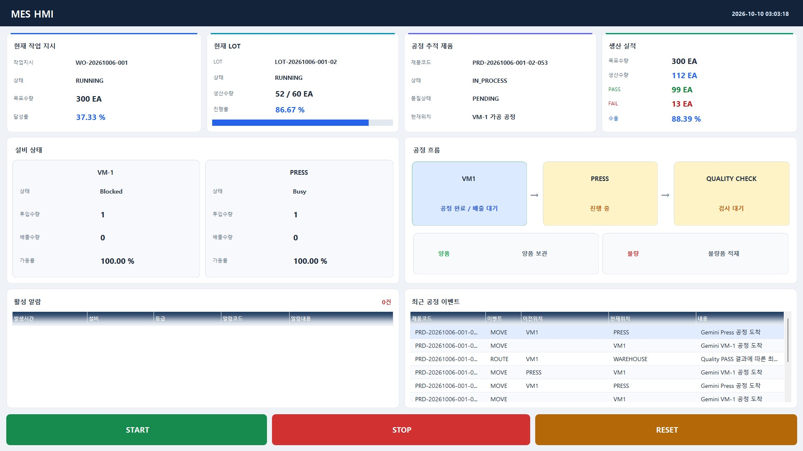
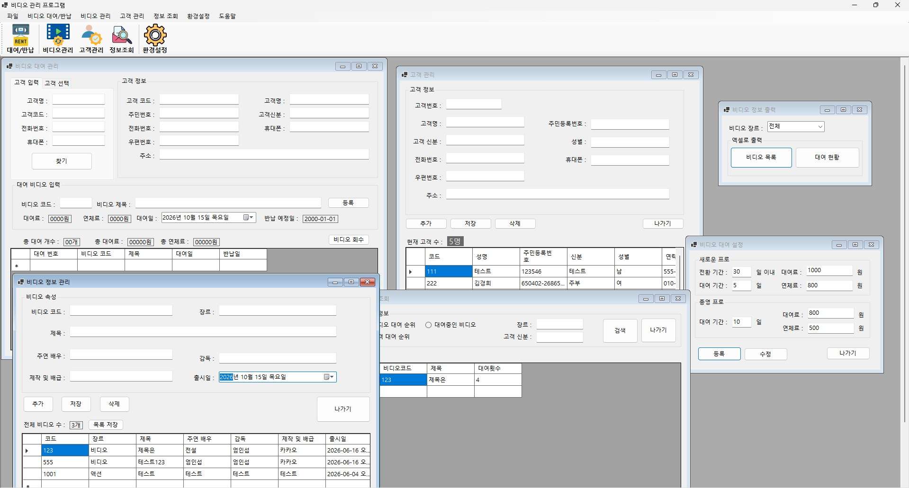
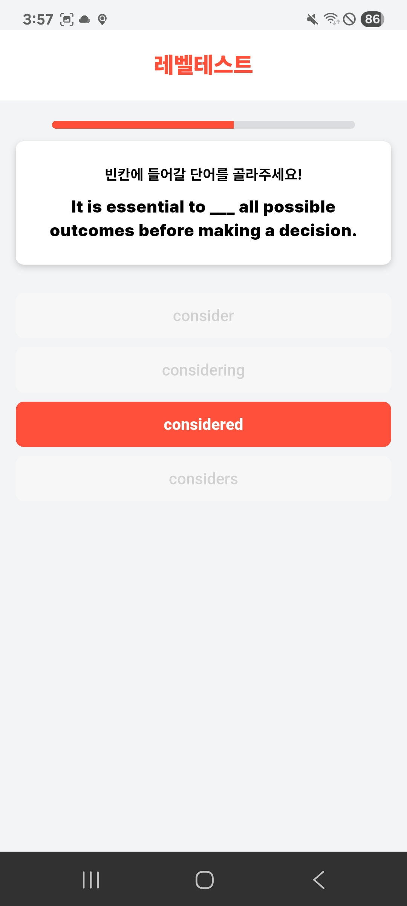
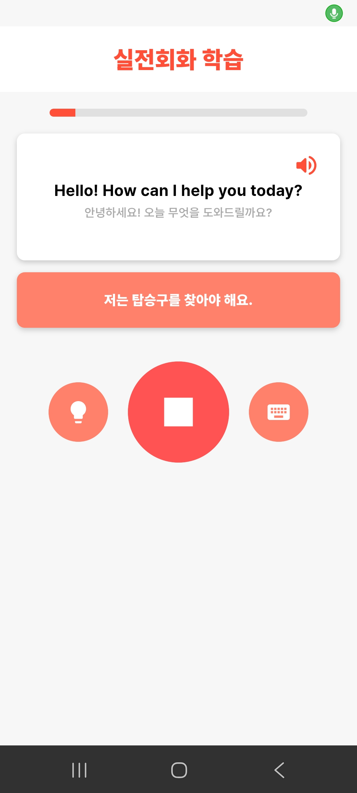
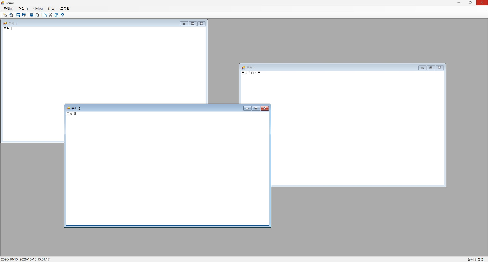
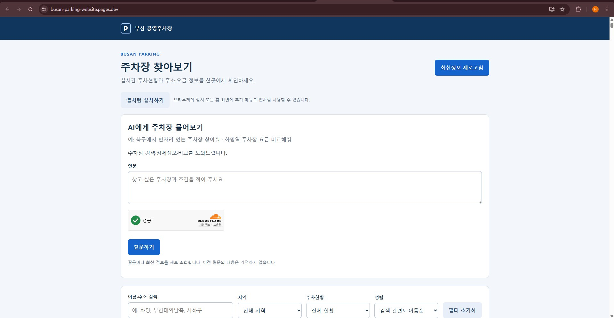

# 엄유준

대학 진학 전, 제조 현장에서 자동화 설비를 운영한 경험이 있습니다. 대학에서는 **C#으로 조회·입력 화면을 만들고, 서버·DB·PLC 시뮬레이터를 연결하는 프로젝트**를 진행했습니다.

한국폴리텍대학 부산캠퍼스 소프트웨어융합과 · [이메일] : pom159753@gmail.com

| 기술 | 프로젝트에서 사용한 범위 |
| --- | --- |
| C# · WinForms | 조회·등록·수정·삭제 화면, 비동기 DB·API 호출, 화면 갱신 |
| MSSQL · ADO.NET | 테이블 관계, JOIN·집계, 저장 프로시저 작성·호출, 트랜잭션 처리 |
| ASP.NET Core | 화면과 DB를 연결하는 저장·조회 API |
| MQTT · SignalR · MX Component | 설비 데이터 수신, 제어 명령 전달, PLC 시뮬레이터 디바이스 읽기·쓰기 |

## PLC 설비 제어 · 생산정보 수집 프로그램

**HMI의 조작이 설비 동작으로 이어지고, 제품의 이동·검사 결과가 DB와 화면에 반영되는 흐름을 연결했습니다.**

- **제어:** HMI → 서버 → Gateway → PLC 시뮬레이터로 시작·정지·초기화 명령 전달
- **수집·저장:** MQTT로 제품 이동·검사 결과 수신, 제품·LOT 관련 변경을 트랜잭션으로 처리
- **동작 확인:** 동일 제품의 이동 → FAIL 판정 → 불량 적재 이력 조회, 알람 발생·표시·해제 확인

개인 프로젝트로, 외부 업체에서 제공받은 가상 설비 모델을 활용했습니다. **요구사항과 전체 시스템 구조(HMI·서버·Gateway·DB의 역할 및 데이터 흐름)를 직접 정하고**, AI는 세부 설계·코드 작성·수정에 활용했습니다. 적용한 기능은 로그·화면·DB로 검증하고, 외부 업체와 오류 현상·측정 결과를 공유한 과정을 문서화했습니다.

**설계 내용 및 협업을 위한 기록:** [본인 역할·AI 활용·기술 커뮤니케이션](https://github.com/EddieEom/MES-System/blob/main/docs/project-ownership-and-communication.md) · [실제 코드 호출 경로 추적 가이드](https://github.com/EddieEom/MES-System/blob/main/docs/code-trace-guide.md)

**[▶ 설비·HMI 연동 시연 영상 보기 · 약 26초](https://github.com/EddieEom/MES-System/blob/main/docs/media/hmi-gemini-demo.mp4)**
노트북에는 작업자 HMI, 외부 모니터에는 가상 설비가 표시됩니다. 영상에서 가상 설비의 움직임과 HMI 상태 변화를 함께 볼 수 있습니다.

**추가 검증:** Gateway MQTT 수신 코드를 사용한 1분 부하·TCP 단절 복구 시험에서 60,100개 고유 ID를 수신했습니다(초당 약 1,000개, 이번 시험 누락·중복 0). PLC·운영 DB·HMI 전체 성능과는 구분합니다. [시험 조건과 결과](https://github.com/EddieEom/MES-System/blob/main/docs/validation/mqtt-reliability.md)

[통신 구조 · 관련 코드 · 문제 해결 기록](https://github.com/EddieEom/MES-System)

## 비디오 대여 관리 · WinForms와 SQL Server CRUD

**수업의 기본 CRUD 과제를 확장해, 비동기 처리와 저장 프로시저 등 C#·DB 기본기를 연습한 프로젝트입니다.** ADO.NET으로 고객·비디오·대여 관리 기능을 연결한 뒤 `async/await`를 적용하고, DB 정규화와 저장 프로시저 작성·호출을 연습했습니다. 입력 → DB 저장 → 목록 갱신의 처리 순서를 확인하며 각 기술의 쓰임을 익혔습니다.

[실행 화면 · DB 처리 코드 · 학습 과정](https://github.com/EddieEom/VideoRentalSystem)

## VIPA 영어학습 앱 · 팀 백엔드와 API 연동

팀 프로젝트에서 **DB 설계와 FastAPI 백엔드**를 담당했습니다. UI·프론트엔드는 팀원이 구현했고, API 요청·응답 형식을 맞추며 앱과 서버를 연결했습니다.

AI 응답을 문제·회화·학습 기록으로 처리하고, AI Hub 구어체 데이터를 Hugging Face의 기존 CEFR 모델로 분류했습니다. Render 배포와 Supabase 연동도 경험했습니다.

[백엔드 저장소](https://github.com/VipaForENG/Vipa_backend) · [담당 기능과 개발 과정](docs/VIPA_README.md)

## 그 외 학습·실험

Java CRUD · WinForms 기초 · 공공데이터·MCP · AI 앱 실험 펼쳐 보기

### 학생·과정 관리 · Java Spring Boot CRUD

Java·Spring Boot·Maven을 공부하며 웹·REST API CRUD를 구현했습니다. JPA로 SQL Server에 연결하고 검색·정렬·페이징·입력 검증을 적용했습니다.

[실행 화면 · 코드](https://github.com/EddieEom/Java_Student-Management-System)

### MDI 메모장 · WinForms 기초

부모·자식 폼, 메뉴 이벤트, 파일 열기·저장을 공부한 작은 실습입니다.

[폼 · 이벤트 · 파일 처리 코드](https://github.com/EddieEom/csharp-winforms-mdi-notepad)

### 부산 공영주차장 · 공공데이터와 MCP 연결

AI 코드 생성을 적극 활용해 공공데이터 API·MCP 서버·Cloudflare 배포를 연결했습니다. 실행 결과를 확인하며 MCP 연결 오류, 지도 검색 주소, PWA 업데이트 흐름의 수정을 요청하고 반영했습니다.

[배포 사이트](https://busan-parking-website.pages.dev/) · [AI 활용 과정 · MCP 구조](https://github.com/EddieEom/Busan_Parking_Website)

### MindBuilder · AI로 생각과 다음 행동을 정리하는 앱 실험

질문·기록·규칙 기반 분석·LLM 추천을 나누어 구성한 개인 실험입니다. 위 이미지는 저장소의 화면 미리보기입니다.

[아이디어 · 구현 구조 · 진행 상태](https://github.com/EddieEom/MindBuilder)

[학습 기록: LLM의 원리와 AI에게 맡길 범위에 대한 생각](https://github.com/EddieEom/AI-Study-Notes)
