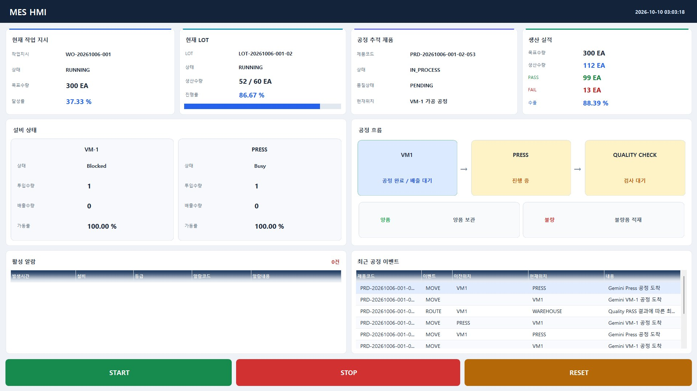
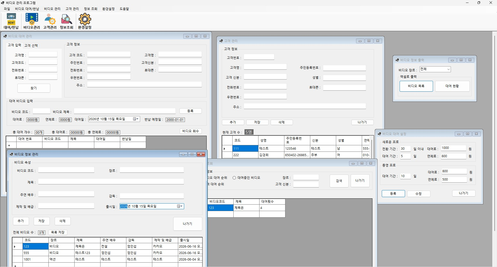
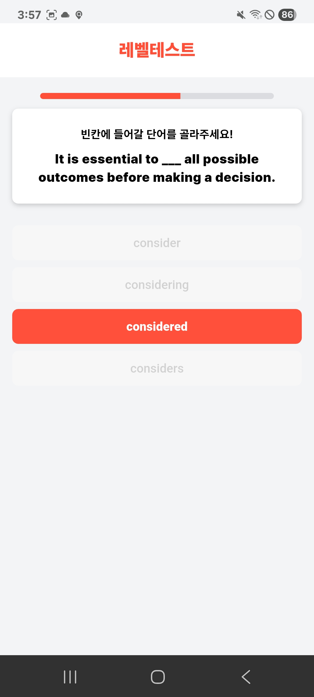
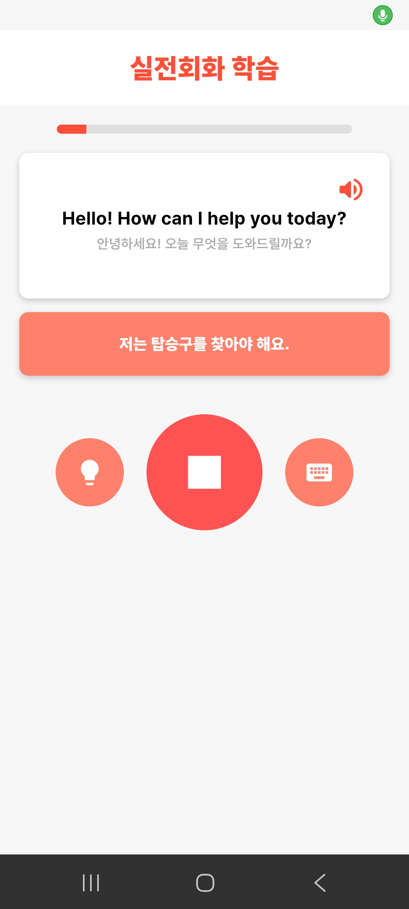
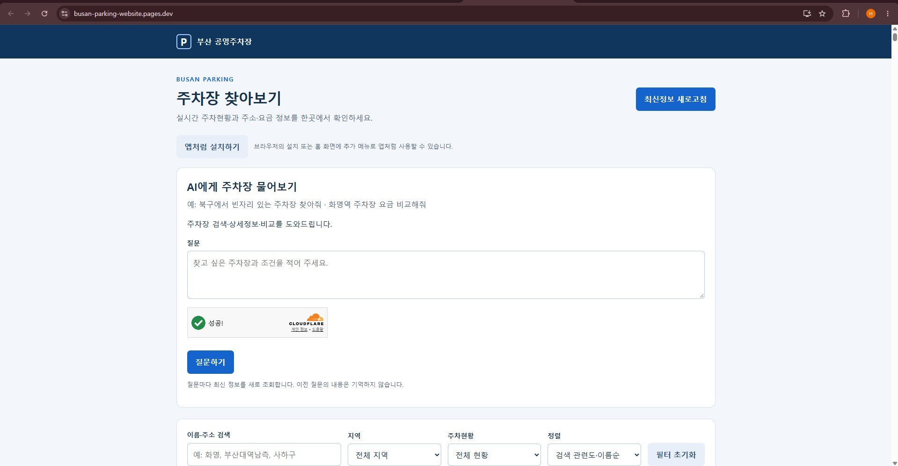

# 엄유준

**스마트팩토리 · MES / 장비제어 SW 엔지니어**

LG이노텍에서 3조 2교대로 설비를 운전하며 에폭시 도포량과 공압을 점검하고, 실제 LOT 수량과 전산 이관 내역을 대조했습니다. 대학에서는 C#으로 작업자 화면을 만들고 PLC 제어 명령, 생산 이력, 온도 알람이 설비와 화면 사이를 오가는 과정을 구현했습니다.

[이메일](mailto:pom159753@gmail.com) · 2001.11.22  

## 핵심 역량

| 영역 | 적용 경험 |
| --- | --- |
| 제조 현장 | 양산 설비 운전, 레시피에 따른 도포량 점검, 설비 알람 초동 조치, LOT 이관 수량 대조 |
| 설비 제어·수집 | HMI에서 PLC 시뮬레이터에 제어 명령 전달, MQTT로 제품 이동·검사 결과 수신, Modbus/TCP로 실장비 온도 수집 |
| 생산 데이터 검증 | SQL Server 트랜잭션으로 검사 결과와 LOT 상태를 함께 갱신하고 화면·로그·DB에서 처리 결과 대조 |

## 경력 사항

**제조 현장 경력 · 총 1년 1개월**

## 학력 사항

| 학교 · 전공 | 기간 | 비고 |
| --- | --- | --- |
| 한국폴리텍대학 부산캠퍼스 · 소프트웨어융합과 | 2025.03 ~ 2027.02 졸업 예정 | 2학년 1학기까지 누적 4.02/4.5 · 학기 평점 1학년 1학기 3.70 → 2학년 1학기 4.31 |
| 부산공업고등학교 · 기계과 | 2017.03 ~ 2020.02 | 졸업 |

## 보유 기술 및 자격

| 구분 | 기술 및 자격 |
| --- | --- |
| 언어·프레임워크 | C#, .NET, WinForms, ASP.NET Core, SQL, Python, Java, Spring Boot |
| 데이터베이스 | SQL Server(MSSQL), MySQL, ADO.NET, 저장 프로시저, 트랜잭션 |
| 통신·도구 | Modbus/TCP, MQTT, SignalR, REST API, MX Component, Git/GitHub, Linux(Ubuntu·WSL) |
| 자격·면허 | 정보처리산업기사 필기 합격 · 실기 결과 대기 / 2종 보통 운전면허 |

## 프로젝트 경험

### 1. 디지털 트윈 연동 프레스 공정 제어 및 모니터링

**2026년 졸업작품 · 팀 프로젝트 · 교내 프로젝트 작품 경진대회 동상**

가상 프레스 설비에서 제품이 이동하고 검사를 마치면 작업자가 HMI에서 해당 제품의 검사 결과와 LOT 이력을 조회할 수 있도록 구현했습니다. ㈜퍼씨엠에서 MELSOFT Gemini 가상 설비 모델을 제공받았고, 작업자 화면과 서버·Gateway·DB 연동을 담당했습니다.

- **제어** · WinForms HMI의 시작·정지·초기화 요청을 ASP.NET Core API로 받아 SignalR로 Gateway에 전달하고, MX Component로 PLC 시뮬레이터의 제어 비트를 변경했습니다.
- **수집** · Gateway가 MQTT로 제품 이동·검사 결과를 수신하고, SQL Server 저장 프로시저에서 검사 결과와 제품·LOT 상태 변경을 하나의 트랜잭션으로 처리했습니다.
- **문제 해결** · 가상 설비가 멈출 때 Python 발행 함수의 로그를 확인해 메시지마다 외부 발행 프로그램의 종료를 기다리는 구간을 찾았습니다. 프로세스를 한 번 실행해 재사용하고 종료 시 표준입력을 닫도록 수정한 뒤, 같은 조건에서 설비가 계속 동작하는 것을 확인했습니다.

[26초 시연 영상](https://github.com/EddieEom/MES-System/blob/main/docs/media/hmi-gemini-demo.mp4) · [지연 원인과 수정 코드](https://github.com/EddieEom/MES-System/blob/main/MES_Gemini_MQTT_통신최적화_트러블슈팅_2026-10-06.md#debugging-summary) · [MQTT 수신 시험](https://github.com/EddieEom/MES-System/blob/main/docs/validation/mqtt-reliability.md) · [프로젝트 저장소](https://github.com/EddieEom/MES-System)

### 2. SIG-5560 실시간 온도 모니터링

**개인 프로젝트 · C# / .NET 8 · WinForms · Modbus/TCP · ScottPlot · SQL Server**

- **장비 통신** · 약 1초마다 Modbus/TCP의 FC04로 SIG-5560의 입력 레지스터를 읽었습니다. 센서 상태가 정상이면 온도를 요청하고 응답의 트랜잭션 ID를 확인한 뒤 최근 10분 추이를 표시했습니다.
- **알람 처리** · 80℃ 이상이 세 번 연속 측정되면 고온 알람과 카카오톡 발송 대기를 DB에 함께 저장했습니다. 작업자 확인 시각과 정상 복귀 시각을 따로 기록해 두 사건의 순서를 추적했습니다.
- **실장비 검증** · 19번 알람은 93.6℃에서 발생했습니다. 이력 화면과 카카오톡 메시지에서 알람 번호·온도·발생 시각이 일치했고, 작업자 확인 19초 후 정상 복귀가 기록됐습니다.

[프로젝트 저장소](https://github.com/EddieEom/Temperature_ModBus) · [실장비 시험 기록](https://github.com/EddieEom/Temperature_ModBus/blob/main/docs/verification.md) · [장비 연결 트러블슈팅](https://github.com/EddieEom/Temperature_ModBus/blob/main/docs/troubleshooting.md)

### 3. 비디오 대여 관리 시스템

**개인 프로젝트 · C# · WinForms · ADO.NET · SQL Server**

고객·비디오 정보를 등록·조회·수정·삭제하고, 대여와 반납을 처리하는 프로그램입니다. ADO.NET으로 저장 프로시저를 호출하고 비동기 DB 작업이 끝난 뒤 목록을 갱신했습니다. JOIN과 집계로 대여 현황을 조회하고 ClosedXML로 결과를 Excel에 출력했습니다.

[프로젝트 저장소](https://github.com/EddieEom/VideoRentalSystem)

## VIPA 영어학습 앱 · 팀 백엔드와 API 연동

팀 프로젝트에서 **DB 설계와 FastAPI 백엔드**를 담당했습니다. UI·프론트엔드는 팀원이 구현했고, API 요청·응답 형식을 맞추며 앱과 서버를 연결했습니다.

AI 응답을 문제·회화·학습 기록으로 처리하고, AI Hub 구어체 데이터를 Hugging Face의 기존 CEFR 모델로 분류했습니다. Render 배포와 Supabase 연동도 경험했습니다.

[백엔드 저장소](https://github.com/VipaForENG/Vipa_backend) · [담당 기능과 개발 과정](docs/VIPA_README.md)

## 그 외 학습·실험

Java CRUD · WinForms 기초 · 공공데이터·MCP · AI 앱 실험 펼쳐 보기

### 학생·과정 관리 · Java Spring Boot CRUD

Java·Spring Boot·Maven을 공부하며 웹·REST API CRUD를 구현했습니다. JPA로 SQL Server에 연결하고 검색·정렬·페이징·입력 검증을 적용했습니다.

[실행 화면 · 코드](https://github.com/EddieEom/Java_Student-Management-System)

### MDI 메모장 · WinForms 기초

부모·자식 폼, 메뉴 이벤트, 파일 열기·저장을 공부한 작은 실습입니다.

[폼 · 이벤트 · 파일 처리 코드](https://github.com/EddieEom/csharp-winforms-mdi-notepad)

### 부산 공영주차장 · 공공데이터와 MCP 연결

공공데이터 API·MCP 서버·Cloudflare 배포를 연결했습니다. 실행 결과를 확인하며 MCP 연결 오류, 지도 검색 주소, PWA 업데이트 흐름의 수정을 요청하고 반영했습니다.

[배포 사이트](https://busan-parking-website.pages.dev/) · [개발 과정 · MCP 구조](https://github.com/EddieEom/Busan_Parking_Website)

### MindBuilder · AI로 생각과 다음 행동을 정리하는 앱 실험

질문·기록·규칙 기반 분석·LLM 추천을 나누어 구성한 개인 실험입니다. 위 이미지는 저장소의 화면 미리보기입니다.

[아이디어 · 구현 구조 · 진행 상태](https://github.com/EddieEom/MindBuilder)

[학습 기록: LLM의 원리와 AI에게 맡길 범위에 대한 생각](https://github.com/EddieEom/AI-Study-Notes)
